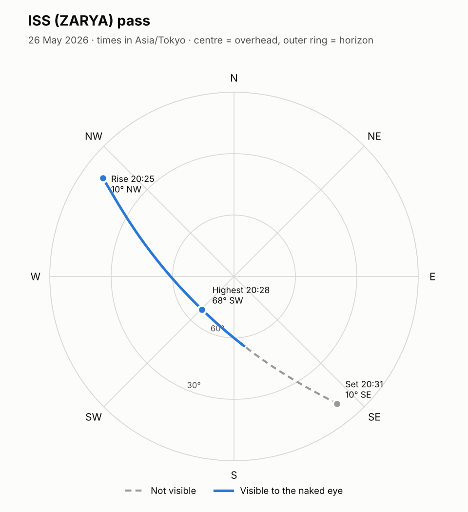

# satpass 🛰️

[](https://github.com/NSW-0/sat-pass-predictor/actions/workflows/tests.yml)

**Predict when the International Space Station (or any satellite) passes over you, and whether you can actually see it with your own eyes.**

A command-line tool written in Python. It downloads the satellite's latest orbit, propagates it forward with the SGP4 orbital model, finds every pass over your location, and works out which ones are visible: the satellite has to be in sunlight while your sky is dark.



*An ISS pass over Tokyo on 26 May 2026. It rises in the north-west in full sunlight, climbs to 68°, then disappears as it flies into Earth's shadow.*

## Example

```text
$ satpass --lat 35.68 --lon 139.69 --tz Asia/Tokyo --days 2

ISS (ZARYA) (NORAD 25544) over 35.6800°N, 139.6900°E
Times in Asia/Tokyo · orbit data is 2.1 days old

Date         Rise from  Highest    at    Set to     Length  Visible
-------------------------------------------------------------------
2026-05-26  12:17 SSW       30° 12:20  12:23 ENE    5m 56s  no
2026-05-26  13:54 W         24° 13:57  14:00 NNE    5m 37s  no
2026-05-26  18:49 N         15° 18:51  18:53 ENE    4m 10s  no
2026-05-26  20:25 NW        68° 20:28  20:31 SE     6m 37s  yes, ~4 min
2026-05-27  11:30 S         17° 11:32  11:35 E      4m 24s  no
2026-05-27  13:06 WSW       40° 13:09  13:12 NE     6m 20s  no
2026-05-27  18:02 N         11° 18:03  18:04 NE     2m 02s  no
2026-05-27  19:37 NW        63° 19:40  19:43 ESE    6m 36s  yes, ~6 min
2026-05-27  21:16 WSW       10° 21:17  21:17 SW     0m 59s  no
```

Most passes happen in daylight or while the station is in Earth's shadow. Only two of these nine are worth going outside for.

## Features

- Pass prediction for any satellite by NORAD number, with short names for `ISS`, `HST` (Hubble) and `CSS` (Tiangong)
- Naked-eye visibility for every pass, including how many minutes of it you can see
- Rise, highest point and set, with times in your time zone and compass directions
- Sky chart of a pass as a PNG (`--plot`)
- JSON output for use in other programs (`--json`)
- Works offline: orbits are cached for 12 hours, and an old copy is used if the download fails
- Tested on Python 3.10 to 3.13 with GitHub Actions

## Install

```bash
git clone https://github.com/NSW-0/sat-pass-predictor.git
cd sat-pass-predictor
pip install -e ".[plot]"
```

If your terminal says `satpass` is not recognized (common on Windows when Python's Scripts folder is not on your PATH), use `python -m satpass` instead, with the same options.

## Usage

```bash
# ISS passes over your location for the next 3 days, in your time zone
satpass --lat 51.48 --lon 0.00 --tz Europe/London

# Only the passes you can see, plus a sky chart of the first one
satpass --lat 51.48 --lon 0.00 --tz Europe/London --visible-only --plot pass.png

# The Hubble Space Telescope, a full week, only passes higher than 30°
satpass --lat 51.48 --lon 0.00 --sat HST --days 7 --min-alt 30

# Any satellite by its NORAD catalog number, as JSON
satpass --lat 51.48 --lon 0.00 --sat 48274 --json
```

Run `satpass --help` for every option. Latitude is positive north, longitude is positive east.

## How it works

1. **Orbit data.** A satellite's orbit is published as a *two-line element set* (TLE), downloaded from [CelesTrak](https://celestrak.org). The tool checks each line's checksum and caches the result, because CelesTrak asks users not to download the same data more often than it changes.
2. **Propagation.** The [SGP4](https://en.wikipedia.org/wiki/Simplified_perturbations_models) model, via the [Skyfield](https://rhodesmill.org/skyfield/) library, turns the TLE into the satellite's position at any moment. It accounts for Earth's flattening and atmospheric drag.
3. **Finding passes.** Skyfield searches the time window for the moments the satellite crosses the minimum altitude (rise and set) and reaches its highest point. These events are grouped into passes.
4. **Visibility.** About 60 points along each pass are checked for two things: whether the satellite is in sunlight, using the Sun's position from NASA JPL's DE421 ephemeris, and whether the Sun is at least 6° below your horizon, so that your sky is dark. The satellite is visible only when both are true.

A test cross-checks the sunlight calculation against an independent cylindrical Earth-shadow model.

## Project layout

```text
src/satpass/
  tle.py       download, cache, parse and validate TLEs
  passes.py    pass search and visibility (the core logic)
  plot.py      sky chart with matplotlib
  cli.py       command-line interface
tests/         pytest suite using a real ISS TLE, so it never needs the internet
```

## Running the tests

```bash
pip install -e ".[dev]"
pytest
```

## Limitations

- SGP4 accuracy falls as the TLE gets older. The tool warns when the orbit data is more than 7 days from your search window.
- A pass already under way when the search starts is skipped.
- It does not yet estimate how bright the satellite will look.

## Ideas for next steps

- Brightness (magnitude) estimates for each pass
- Notifications before a visible pass
- A small web page showing the next visible pass on a map

## Credits

Orbit data from [CelesTrak](https://celestrak.org). Orbital calculations by [Skyfield](https://rhodesmill.org/skyfield/). Ephemeris bundled by [skyfield-data](https://pypi.org/project/skyfield-data/).

## License

[MIT](LICENSE)
